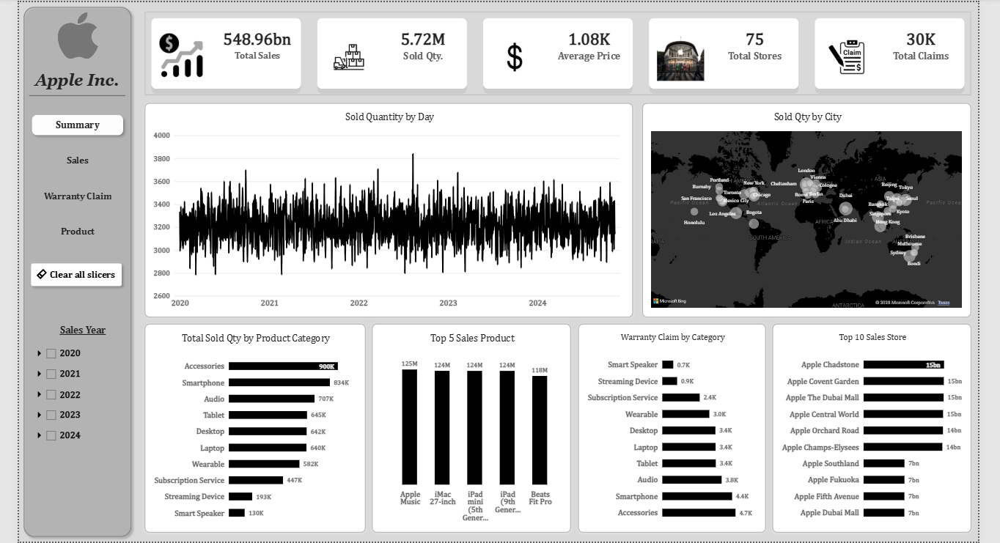
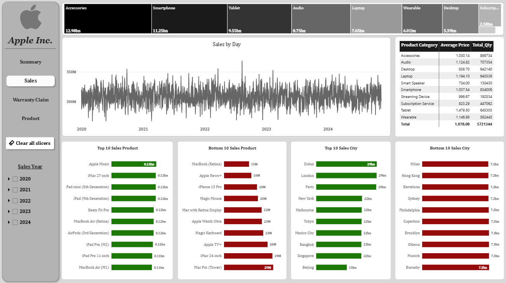
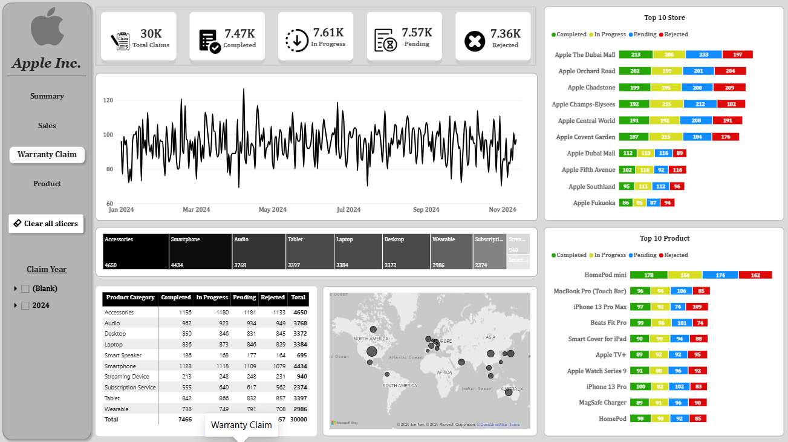
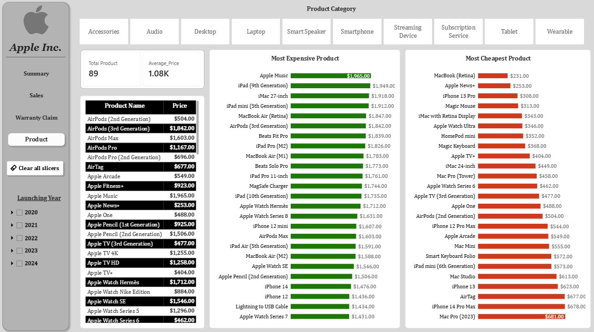

# Apple Inc. – Power BI Analytics Dashboard

## 📌 Project Overview

This project is an interactive **Apple Inc. Business Analytics Dashboard** developed using Microsoft Power BI.

The dashboard provides insights into sales performance, product analysis, product pricing, and warranty claims. It helps understand business performance through KPIs, charts, tables, and interactive filters.

## 📊 Dashboard Pages

### 1. Summary Dashboard
- Total Sales: 548.96bn
- Total Sold Quantity: 5.72M
- Average Product Price: 1.08K
- Total Stores: 75
- Total Warranty Claims: 30K
- Sales quantity trends by day
- Sales performance by city and product category

### 2. Sales Dashboard
- Sales trends by day and year
- Top 10 sales products
- Bottom 10 sales products
- Top 10 sales cities
- Bottom 10 sales cities
- Sales performance by product category
- Average price and total quantity analysis

### 3. Warranty Claim Dashboard
- Total Warranty Claims
- Completed Claims
- In Progress Claims
- Pending Claims
- Rejected Claims
- Warranty claims by product category
- Top 10 stores by claim status
- Top 10 products by claim status

### 4. Product Dashboard
- Total Product Count
- Average Product Price
- Most Expensive Products
- Cheapest Products
- Product category analysis
- Product name and price details
- Interactive product category filters

## 🛠️ Tools & Technologies

- Microsoft Power BI
- Power Query
- DAX Formulas
- Data Cleaning & Transformation
- Data Modeling
- Data Visualization
- Interactive Dashboard Design

## 📸 Dashboard Preview

### 1. Summary Dashboard

### 2. Sales Dashboard

### 3. Warranty Claim Dashboard

### 4. Product Dashboard

### 5. Animated Dashboard Preview

## 🎯 Key Learnings

- Data cleaning and transformation using Power Query.
- Creating calculated measures using DAX.
- Developing interactive KPI cards.
- Building professional Power BI dashboards.
- Analyzing sales and product performance.
- Monitoring warranty claim status.
- Creating interactive filters and data visualizations.

## 💡 Project Objective

The main objective of this project is to convert business data into meaningful insights and create an interactive reporting solution to support better business decisions.

## 👨‍💻 Author

**Kaleem Asharaf**

## ⭐ Feedback

Thank you for visiting my project!

If you find this project useful, please give it a ⭐ on GitHub.

Your feedback and suggestions are always welcome!
